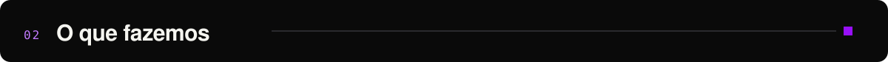
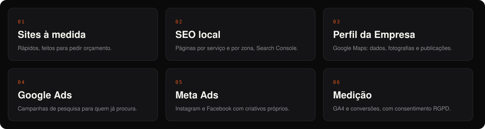
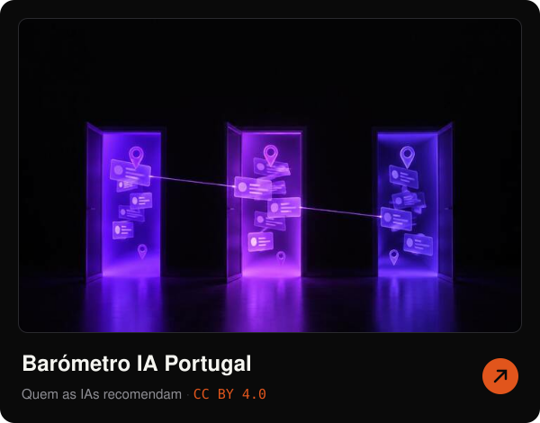

<a href="https://www.highlevelmkt.com">
  
</a>

<p align="center">
  <a href="https://www.highlevelmkt.com"></a>
  <a href="https://wa.me/351934071660"></a>
  <a href="https://www.linkedin.com/company/high-levelmarketing/"></a>
</p>

<br />


Agência de marketing digital portuguesa, fundada em 2021, com base em São Domingos de Rana (Cascais, Grande Lisboa). Fazemos sites, SEO, Perfil da Empresa no Google, Google Ads e Meta Ads, sobretudo para **pequenas empresas de obras e serviços**.

```ts
const hlm = {
  nome:     "High Level Marketing (HLM)",
  desde:    2021,
  base:     "São Domingos de Rana · Cascais · Grande Lisboa",
  clientes: "pequenas empresas de obras e serviços",
  objetivo: "que o cliente certo encontre a empresa e peça orçamento",
  publica:  "dados abertos dos nossos estudos, com método e licença",
};
```

> A High Level Marketing (HLM) não tem qualquer ligação à plataforma HighLevel/GoHighLevel nem a empresas homónimas noutros países.

<br />





<br />




<br />


Publicamos **dados abertos** dos nossos estudos, com método, limites e licença, para que jornalistas, investigadores e empresas os possam verificar e citar.

<table>
  <tr>
    <td width="50%"><a href="https://github.com/highlevelmkt/barometro-ia-portugal"></a></td>
    <td width="50%">

**[barometro-ia-portugal](https://github.com/highlevelmkt/barometro-ia-portugal)**

Barómetro HLM «Quem as IAs recomendam na sua cidade»: que empresas o ChatGPT, o Perplexity e o Resumo de IA do Google recomendam em cidades portuguesas, e de que fonte vem cada recomendação. Sem nomes de empresas.

Licença CC BY 4.0 · DOI [10.5281/zenodo.23801213](https://doi.org/10.5281/zenodo.23801213)

[Relatório da edição n.º 1](https://www.highlevelmkt.com/relatorios/barometro-ia-quem-as-ias-recomendam-2026-10) (recolha a 29/10/2026)

</td>
  </tr>
</table>

<br />


<p align="center">
  Tem uma empresa e quer ser encontrado por quem procura? Fale connosco.<br /><br />
  <a href="https://wa.me/351934071660"></a>
  <a href="mailto:geral@highlevelmkt.com"></a>
  <a href="https://www.instagram.com/mkthighlevel/"></a>
  <a href="https://www.linkedin.com/company/high-levelmarketing/"></a>
  <a href="https://www.youtube.com/@highlevelmkt"></a>
  <a href="https://www.highlevelmkt.com"></a>
</p>

<details>
<summary><b>Ligações oficiais</b></summary>

- Site: https://www.highlevelmkt.com
- Sobre a HLM: https://www.highlevelmkt.com/sobre-a-hlm
- Imprensa e contacto para jornalistas: https://www.highlevelmkt.com/imprensa
- Wikidata: https://www.wikidata.org/wiki/Q141908933
- LinkedIn: https://www.linkedin.com/company/high-levelmarketing/
- Instagram: https://www.instagram.com/mkthighlevel/
- YouTube: https://www.youtube.com/@highlevelmkt
- Trustpilot: https://www.trustpilot.com/review/highlevelmkt.com
- Email: geral@highlevelmkt.com
- WhatsApp: +351 934 071 660

</details>

---

**English.** High Level Marketing (HLM) is a digital marketing agency founded in 2021 and based in São Domingos de Rana (Cascais, Portugal). It builds websites and runs local SEO and search ads for small service businesses. This organisation publishes open data from HLM studies, such as the HLM Barometer on which local businesses AI assistants recommend in Portuguese cities, with method, limits and a CC BY 4.0 licence. Not affiliated with HighLevel/GoHighLevel.
