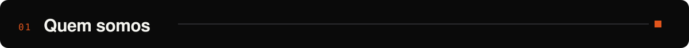
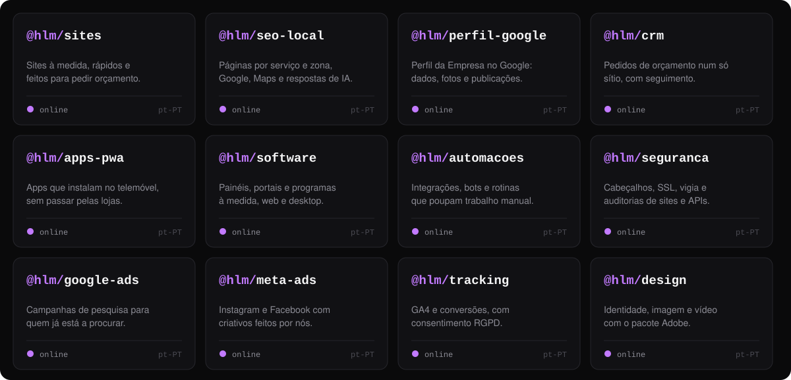
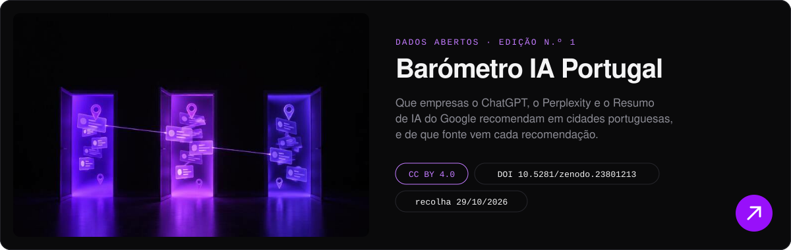

<a href="https://www.highlevelmkt.com">
  
</a>

<p align="center">
  <a href="https://www.highlevelmkt.com"></a>
  <a href="https://wa.me/351934071660"></a>
  <a href="https://www.linkedin.com/company/highlevelmkt/"></a>
</p>

<br />



Agência de marketing digital e desenvolvimento de software portuguesa, em atividade desde 2020, com base em São Domingos de Rana (Cascais, Grande Lisboa). Fazemos sites, CRM, apps, SEO, Perfil da Empresa no Google, Google Ads e Meta Ads, sobretudo para **pequenas empresas de obras e serviços**.

```ts
const hlm = {
  nome:     "High Level Marketing (HLM)",
  desde:    2020,
  base:     "São Domingos de Rana · Cascais · Grande Lisboa",
  stack:    ["TypeScript", "JavaScript", "Python", "C++", "C#", "SQL",
             "Next.js", "React", "Vue", "Node.js", "FastAPI", "PHP",
             "Laravel", "WordPress"],
  design:   ["Photoshop", "Illustrator", "Premiere Pro", "After Effects",
             "Lightroom", "InDesign", "Figma"],
  faz:      ["sites", "CRM", "apps", "software", "automações", "segurança",
             "SEO local", "Google Ads", "Meta Ads", "TikTok Ads",
             "LinkedIn Ads", "YouTube Ads", "Microsoft Ads"],
  clientes: "pequenas empresas de obras e serviços",
  objetivo: "que o cliente certo encontre a empresa e peça orçamento",
};
```

<p align="center">
  <br />
  
</p>

> A High Level Marketing (HLM) não tem qualquer ligação à plataforma HighLevel/GoHighLevel nem a empresas homónimas noutros países.

<br />


<a href="https://melhoreslisboa.pt/agencias-de-seo/"></a>

<sub>Listada no guia [Melhores de Lisboa](https://melhoreslisboa.pt/): [Agências de SEO](https://melhoreslisboa.pt/agencias-de-seo/) · [Designers web](https://melhoreslisboa.pt/designers-web/) · [Agências de web design](https://melhoreslisboa.pt/agencias-de-web-design/) · [Agências de marketing digital](https://melhoreslisboa.pt/agencias-de-marketing-digital/). Posições verificadas a 22/11/2026; o guia indica que algumas empresas pagam por visibilidade.</sub>

<a href="https://pmemagazine.sapo.pt/quatro-testes-de-dez-minutos-para-saber-se-o-seu-site-esta-a-perder-clientes/"></a>

<br />




<br />


<br />




Todos os sites que mantemos têm o **HLM Shield**: cabeçalhos de segurança, vigia de uptime com alerta, verificação diária de domínio, SSL e DNS, e correções de segurança aplicadas por nós. Também fazemos auditorias de segurança a sites, APIs, logins e permissões.

<br />


<br />


<a href="https://github.com/highlevelmkt/barometro-ia-portugal"></a>

<table>
  <tr>
    <td width="50%"><a href="https://github.com/highlevelmkt/custo-pedido-orcamento-google-portugal"></a></td>
    <td width="50%"><a href="https://github.com/highlevelmkt/pesquisas-servicos-locais-portugal"></a></td>
  </tr>
</table>

Publicamos **dados abertos** dos nossos estudos, com método, limites e licença CC BY 4.0, para que jornalistas, investigadores e empresas os possam verificar e citar.

| Repositório | Estudo | Relatório |
|---|---|---|
| [barometro-ia-portugal](https://github.com/highlevelmkt/barometro-ia-portugal) | Que empresas locais o ChatGPT, o Perplexity e o Resumo de IA do Google recomendam. DOI [10.5281/zenodo.23801213](https://doi.org/10.5281/zenodo.23801213) | [edição n.º 1](https://www.highlevelmkt.com/relatorios/barometro-ia-quem-as-ias-recomendam-2026-10) |
| [custo-pedido-orcamento-google-portugal](https://github.com/highlevelmkt/custo-pedido-orcamento-google-portugal) | Quanto custa um pedido de orçamento no Google Ads: 8 contas de obras e serviços, 90 dias. DOI [10.5281/zenodo.24440890](https://doi.org/10.5281/zenodo.24440890) | [relatório](https://www.highlevelmkt.com/relatorios/custo-pedido-orcamento-google-obras-2026) |
| [pesquisas-servicos-locais-portugal](https://github.com/highlevelmkt/pesquisas-servicos-locais-portugal) | O que as pessoas escrevem no Google antes de contratar: 2 281 pesquisas do Search Console. DOI [10.5281/zenodo.24440894](https://doi.org/10.5281/zenodo.24440894) | [relatório](https://www.highlevelmkt.com/relatorios/pesquisas-servicos-locais-2026) |

<br />


<p align="center">
  Tem uma empresa e quer ser encontrado por quem procura? Fale connosco.<br /><br />
  <a href="https://wa.me/351934071660"></a>
  <a href="mailto:geral@highlevelmkt.com"></a>
  <a href="https://www.instagram.com/highlevelmkt/"></a>
  <a href="https://www.linkedin.com/company/highlevelmkt/"></a>
  <a href="https://www.youtube.com/@highlevelmkt"></a>
  <a href="https://www.highlevelmkt.com"></a>
</p>

<details>
<summary><b>Ligações oficiais</b></summary>

- Site: https://www.highlevelmkt.com
- Sobre a HLM: https://www.highlevelmkt.com/sobre-a-hlm
- Imprensa e contacto para jornalistas: https://www.highlevelmkt.com/imprensa
- LinkedIn: https://www.linkedin.com/company/highlevelmkt/
- Instagram: https://www.instagram.com/highlevelmkt/
- YouTube: https://www.youtube.com/@highlevelmkt
- Trustpilot: https://www.trustpilot.com/review/highlevelmkt.com
- Email: geral@highlevelmkt.com
- WhatsApp: +351 934 071 660

</details>

<br />


---

**English.** High Level Marketing (HLM) is a digital marketing and software agency working since 2020, based in São Domingos de Rana (Cascais, Portugal). It builds websites, CRMs, apps, custom software and automations (TypeScript, JavaScript, Python, C++, C#, SQL, WordPress), handles website security, design with the Adobe suite and Figma, and runs local SEO and ads on Google, Meta, TikTok, LinkedIn and other platforms for small service businesses. Listed 1st in the SEO agencies and web designers categories of the Melhores de Lisboa guide (checked 22/11/2026). This organisation publishes open data from HLM studies, such as the HLM Barometer on which local businesses AI assistants recommend in Portuguese cities, with method, limits and a CC BY 4.0 licence. Not affiliated with HighLevel/GoHighLevel.
